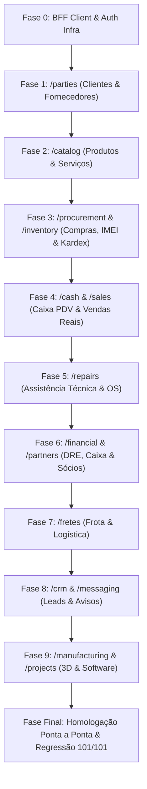

# MISSÃO ENTERPRISE — PLANO DE EXECUÇÃO: INTEGRAÇÃO REAL E HOMOLOGAÇÃO PONTA A PONTA DO HB STUDIO ERP

**Status:** Planejado para Execução Imediata  
**Data:** 17 de novembro de 2026  
**Responsável:** Antigravity / Google DeepMind Team  
**Repositório Oficial:** `https://github.com/HenriqueBuzeto/HBStudio.git`

---

## 1. Visão Geral e Princípios Arquiteturais

A auditoria sênior identificou a assimetria crítica do sistema: o backend (`.NET 10`) possui 16 módulos de domínio consolidados, banco PostgreSQL 18 e 101 testes de integração automatizados aprovados, enquanto as telas do frontend (`Next.js 16`) operam majoritariamente com dados e estados em memória (mocks).

### Princípios Invioláveis da Execução:
1. **Navegador → BFF Next.js → API ASP.NET Core (.NET 10) → PostgreSQL**:
   - O browser **nunca** fará chamadas diretas com tokens expostos.
   - Preservação estrita dos cookies `HttpOnly` (`hb_access_token`) já validados em `/api/auth/login`.
   - O BFF atua como gateway autenticado com tratamento tipado de erros HTTP (`400`, `401`, `403`, `404`, `409`, `500`, `503`).
2. **Preservação Visual HBVisionX**:
   - Zero regressão visual: layouts, paletas de cores, gavetas laterais, modais, cabeçalhos e responsividade permanecem 100% idênticos.
   - Substituição de arrays de mock por estados assíncronos (`isLoading`, `error`, `emptyState`, `data`).
3. **Eliminação Irrestrita de Mocks Operacionais**:
   - Se o banco estiver vazio, exibe empty state real. Nunca preencher silenciosamente com dados fictícios após falha.
4. **Persistência e Transacionalidade Comprovadas**:
   - Nenhuma tela será dada como concluída sem validação pós-F5 (persistência no PostgreSQL) e verificação de regras de negócio entre módulos.

---

## 2. Inventário Técnico e Matriz de Integração (Por Telas)

| Fase | Tela / Rota | Endpoint BFF (`/api/...`) | Endpoint Backend .NET (`/api/...`) | Entidades PostgreSQL | Chave de Permissão | Status Inicial | Status Alvo |
| :---: | :--- | :--- | :--- | :--- | :--- | :---: | :---: |
| **0** | **Base / Infra** | `/api/auth/me`, `/api/proxy` | `/api/auth/*` | `users`, `roles`, `branches` | Canonical Catalog | Configurado | OPERATION_READY |
| **1** | **`/parties`** (Clientes & Fornecedores) | `/api/parties` (GET, POST, PUT, DELETE) | `/api/parties` | `parties`, `party_contacts`, `party_addresses`, `party_consents` | `customers.view`, `customers.create`, `customers.update` | MOCK_ONLY | OPERATION_READY |
| **2** | **`/catalog`** (Catálogo & Produtos) | `/api/catalog` (GET, POST, PUT) | `/api/catalog` | `catalog_products`, `categories`, `brands`, `tax_profiles` | `catalog.products.view`, `catalog.products.manage` | MOCK_ONLY | OPERATION_READY |
| **3** | **`/procurement`** & **`/inventory`** | `/api/procurement`, `/api/inventory` | `/api/procurement`, `/api/inventory` | `purchase_orders`, `devices`, `inventory_items`, `kardex_entries` | `procurement.orders.manage`, `inventory.view`, `inventory.adjust` | MOCK_ONLY | OPERATION_READY |
| **4** | **`/cash`** & **`/sales`** (PDV & Vendas) | `/api/cash`, `/api/sales` | `/api/cash`, `/api/sales`, `/api/fiscal` | `cash_sessions`, `cash_movements`, `sales_orders`, `sale_items`, `fiscal_documents` | `cash.sessions.manage`, `sales.pos.use`, `sales.orders.manage` | MOCK_ONLY | OPERATION_READY |
| **5** | **`/repairs`** (Ordens de Serviço) | `/api/repairs` | `/api/repairs` | `repair_orders`, `repair_items`, `repair_checklists` | `repairs.orders.view`, `repairs.orders.manage` | MOCK_ONLY | OPERATION_READY |
| **6** | **`/financial`** & **`/partners`** | `/api/financial`, `/api/partners` | `/api/financial`, `/api/partners` | `financial_accounts`, `payables`, `receivables`, `partners_capital` | `financial.entries.view`, `financial.manage`, `partners.capital.view` | MOCK_ONLY | OPERATION_READY |
| **7** | **`/fretes`** (Frota & Logística) | `/api/fleet`, `/api/pricing` | `/api/fleet`, `/api/pricing` | `fleet_vehicles`, `fleet_trips`, `fleet_expenses` | `fleet.view`, `fleet.vehicles.manage` | MOCK_ONLY | OPERATION_READY |
| **8** | **`/crm`** & **`/messaging`** | `/api/crm`, `/api/messaging` | `/api/crm`, `/api/messaging` | `crm_leads`, `crm_opportunities`, `messages`, `message_templates` | `crm.opportunities.manage`, `messaging.send` | MOCK_ONLY | OPERATION_READY |
| **9** | **`/manufacturing`** & **`/projects`** | `/api/manufacturing`, `/api/projects` | `/api/manufacturing`, `/api/projects` | `manufacturing_orders`, `digital_projects`, `project_tasks` | `manufacturing.orders.manage`, `projects.view` | MOCK_ONLY | OPERATION_READY |

---

## 3. Roteiro Sequencial de Execução (Fases 0 a 9)

### Detalhamento por Fase:
- **Fase 0:** Criar módulo unificado de cliente BFF no Next.js (`apps/web/lib/api-client.ts`), centralizando headers, cookie `hb_access_token`, deserialização segura e tratamento de erros padrão com `Toast` e feedback visual.
- **Fase 1 (Parties):**
  - Implementar `/api/parties/route.ts` e `/api/parties/[id]/route.ts`.
  - Conectar formulário de PF/PJ, contatos, endereços, pesquisa e listagem paginada.
  - Remover dados mock de `useState` em `apps/web/app/parties/page.tsx`.
- **Fase 2 (Catalog):**
  - Implementar `/api/catalog/route.ts`.
  - Conectar CRUD de produtos, categorias, marcas e impostos no `apps/web/app/catalog/page.tsx`.
- **Fase 3 (Procurement & Inventory):**
  - Implementar rotas `/api/procurement` e `/api/inventory`.
  - Integrar grading de aparelhos, cadastro de IMEIs únicos e movimentação Kardex real em `/procurement/page.tsx` e `/inventory/page.tsx`.
- **Fase 4 (Cash & Sales):**
  - Integrar abertura/sangria/fechamento de caixa em `/cash/page.tsx`.
  - Integrar carrinho do PDV em `/sales/page.tsx` com baixa transacional de estoque, criação de recebível e chamada ao motor fiscal.
- **Fase 5 a 9:**
  - Seguir a esteira estrita conectando as telas remanescentes (`/repairs`, `/financial`, `/partners`, `/fretes`, `/crm`, `/messaging`, `/manufacturing`, `/projects`).
- **Fase de Validação e Homologação:**
  - Criar testes E2E / fluxos automatizados comprovando que recarregar a tela (F5) recupera os dados persistidos no Postgres.
  - Atualizar documentação técnica oficial em `docs/gates/gate-frontend-backend-integration-enterprise.md`.
  - Executar regressão completa (`dotnet test` 101/101 e `next build` 25 rotas).

---

## 4. Critério de Aceite e Prontidão
A missão só é considerada finalizada quando:
1. Nenhuma tela de `/apps/web/app` possuir arrays ou objetos de mock estático como fonte primária de dados.
2. Todas as mutações retornarem códigos de sucesso reais do PostgreSQL.
3. As regressões backend permanecerem com 101/101 testes passando.
4. O build de produção Next.js for compilado sem erros de tipagem.
